<div align="center">

# 🔨 BONK MODE

### A 1999 warez-scene keygen that sends your background apps to **RAM jail**.

*Chiptune included. Dignity optional.*

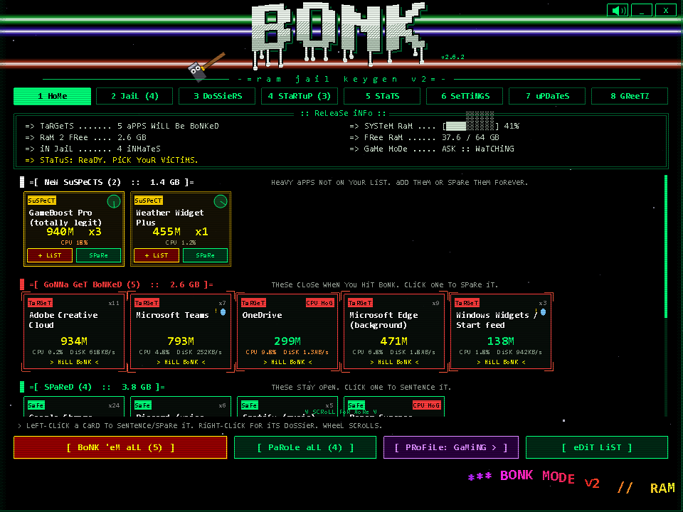

**[Install](#-install-in-30-seconds)** · **[Screens](#-the-tour)** · **[Settings](#%EF%B8%8F-settings)** · **[Updates](#-live-updates)** · **[Versions](#-version-history)** · **[FAQ](#-faq-frequently-bonked-questions)**

</div>

---

## The problem

You have 8 GB of RAM. Maybe 16 if you're lucky. You double-click your game.

Behind your back, **nineteen apps** you forgot existed are syncing files, checking for updates, rendering a weather widget nobody has ever looked at, and each one is holding a gigabyte "just in case." Your game stutters. Your fans scream. Adobe Creative Cloud is thriving.

## The solution

A hammer.

Bonk Mode lives in your system tray. Double-click it and a 1999-style keygen opens, complete with chiptune music, a wobbling ASCII logo and a sine-wave scroller. It shows you **every app eating your RAM**, sorted into **GONNA GET BONKED** and **SPARED**. Hit **BONK 'EM ALL** and a cartoon hammer swings across the screen, smacking each one into a prison cell.

When you're done gaming, grant them **parole** and they come home like nothing happened.

> Built for people on low-RAM laptops, budget gaming rigs, and anyone who has ever opened Task Manager mid-boss-fight and whispered *"who are you people."*

---

## 📸 The tour

### 1 · HOME: know exactly who's about to get bonked


Every app on your list gets a card with its **full name**, live RAM, and process count. Cards are grouped under three headers so there's zero guessing:

- 🔴 **GONNA GET BONKED**: closes when you hit the button. Pulsing crosshairs. Visibly nervous. Occasionally sweats.
- 🟢 **SPARED**: stays open. Your Discord call is safe.
- ⚪ **IN JAIL**: already bonked, waiting for parole.

**Left-click** a card to sentence or spare it. **Right-click** for its dossier. Hover for the full process list.

Every card also shows **CPU** (as a share of your whole machine) and **disk** activity, and anything burning more than 8% of your CPU gets a flashing **CPU HOG** badge.

**Profiles:** the purple **PROFILE** button flips between **gaming**, **streaming** (spares Discord, OBS and Spotify), **work** (spares Teams, Slack, Zoom and browsers, bonks game launchers) and **battery** (bonks nearly everything). Each profile remembers its own checkboxes.

### The bonk

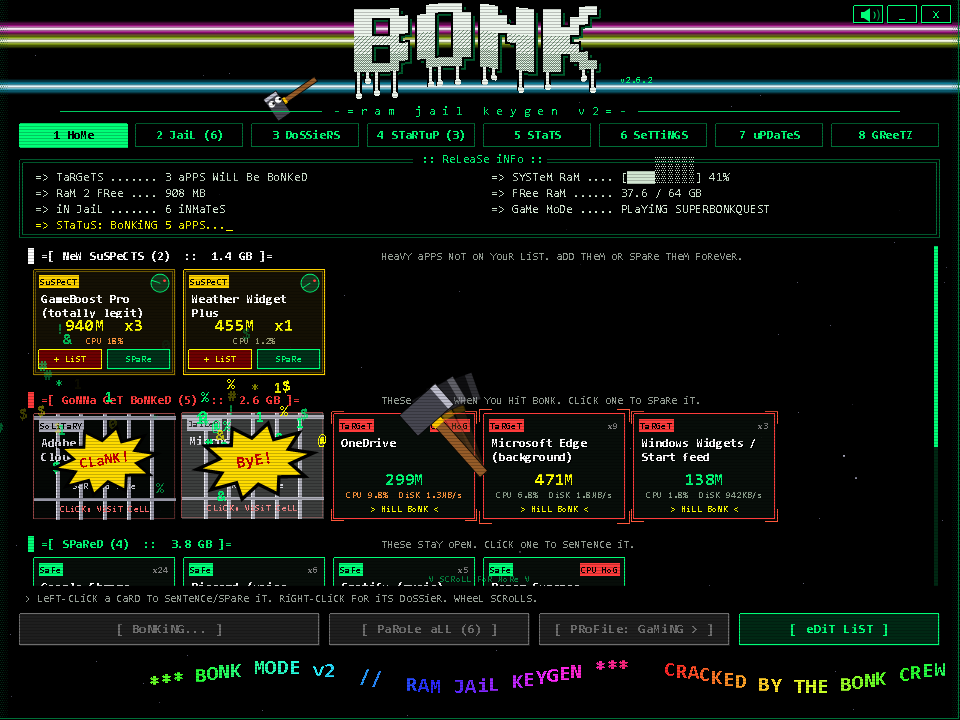

The hammer goes card by card. Every hit flashes white, shakes the screen, sprays RAM bits everywhere, pops a comic **BONK! / WHAM! / BYE! / K.O.!** burst, and slams prison bars down.

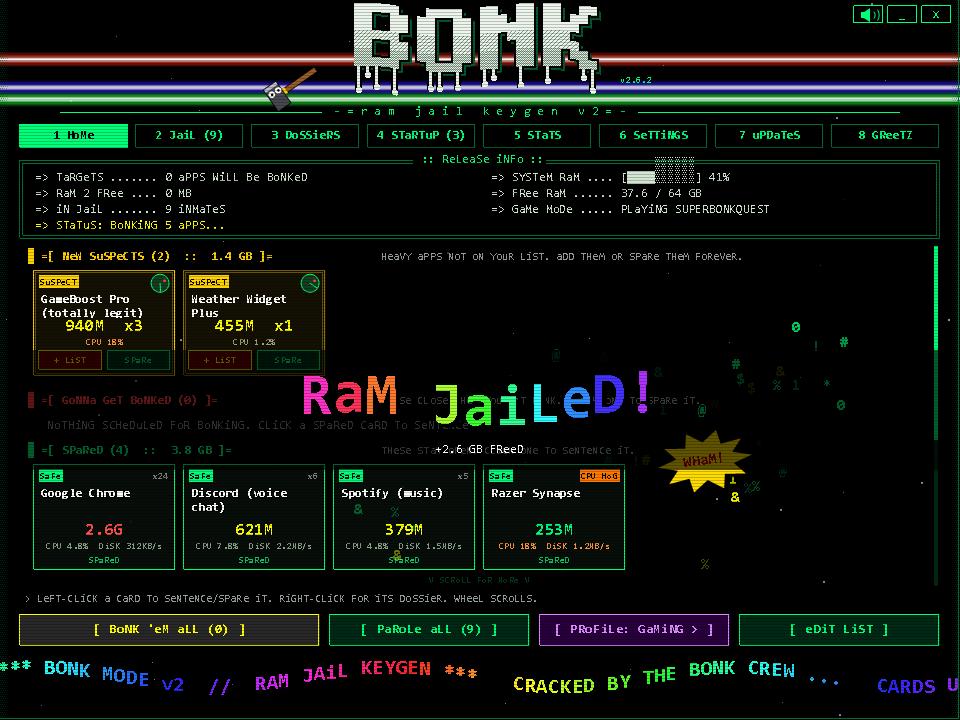

Then the banner tells you how much you freed. Very satisfying. Scientifically proven*.

<sub>*not scientifically proven</sub>

### AUTO GAME MODE: it bonks for you

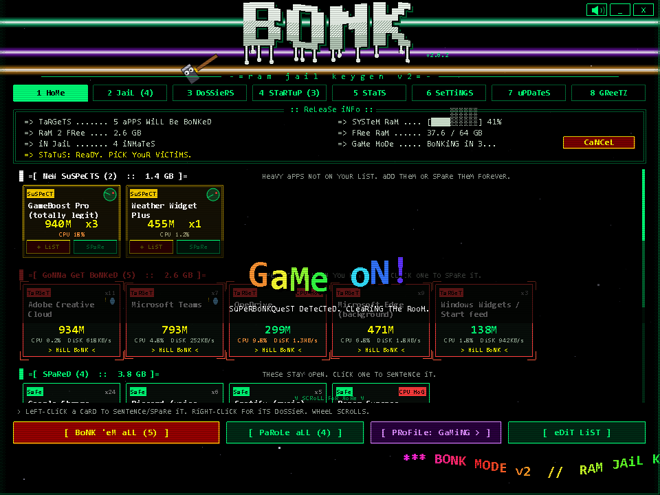

Start a game and Bonk Mode notices: **GAME ON!** It counts down five seconds (click the notification or **CANCEL** if you want everything left open), then clears the room. Quit the game, and ten seconds later everything it bonked comes back on parole. You never have to remember.

It watches every Steam library on your PC (read straight from Steam), plus Epic, Xbox, EA, Ubisoft and GOG folders. Got a game somewhere else? Add its folder or exe name to the `games` block in your `bonk-list.json`. The game you're playing is never bonked, even if it's on your list. Set it to **off**, **ask** (default) or **auto** in Settings or the tray menu.

### HOG RADAR: new suspects, flagged for you


Every 30 seconds the radar sweeps your PC for heavy apps that aren't on your list yet. Anything over the threshold (400 MB by default) shows up as a gold **NEW SUSPECT** card at the top of Home, with a little radar dish spinning in the corner. Hit **[+ LIST]** to sentence it, or **[SPARE]** to ignore it forever. Your list maintains itself.

The radar never suggests Windows itself, shared engines other apps run on (like Edge WebView2), or developer and server runtimes (node, java, Docker), so it won't tempt you into bonking your Minecraft server.

### 2 · CELL BLOCK: visit the inmates

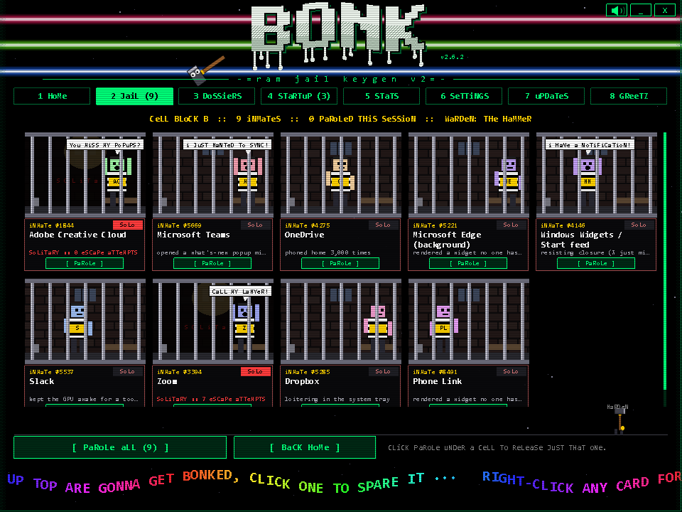

Every jailed app becomes a **striped inmate** with its initials on its shirt, pacing its cell. They grab the bars and yell things like *"I JUST WANTED TO SYNC!"* and *"CALL MY LAWYER!"* Each has an inmate number and a crime: *"opened a what's-new popup mid-raid"*, *"loitering in the system tray"*, *"resisting closure (X just minimizes)"*.

Click **[PAROLE]** under one cell and that inmate's bars slide open and it sprints off screen.

**Solitary confinement:** some apps restart themselves after a bonk (watchdogs, updaters, helper services). Flip their cell to **SOLO** and they get shut straight back down within 3 seconds, with every escape attempt counted on their plate, a siren, and an **ESCAPE FOILED!** banner. Solitary cells are pitch dark with one flickering bulb. And if *you* open a jailed app yourself from the Start menu or taskbar, Bonk Mode sees that and paroles it instead of fighting you. A warden hammer patrols the corridor. If the jail is empty, a tumbleweed rolls by.

### 3 · DOSSIERS: the rap sheet

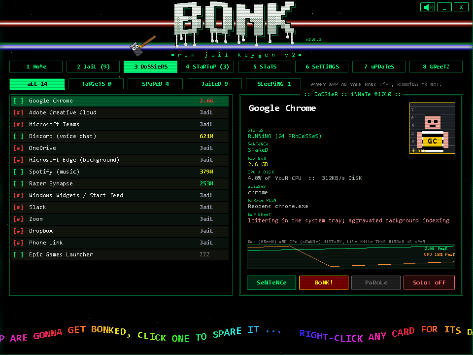

Every app on your list, running or asleep, filterable by **targets / spared / jailed / sleeping**. Each dossier has a mugshot against a height chart, its live status, every process alias it hides behind, what parole will do to bring it back, its rap sheet, and a **live RAM history chart**. Sentence it, spare it, **BONK NOW** just that one, or parole it from here.

### 4 · STARTUP JAIL: faster boot, every day

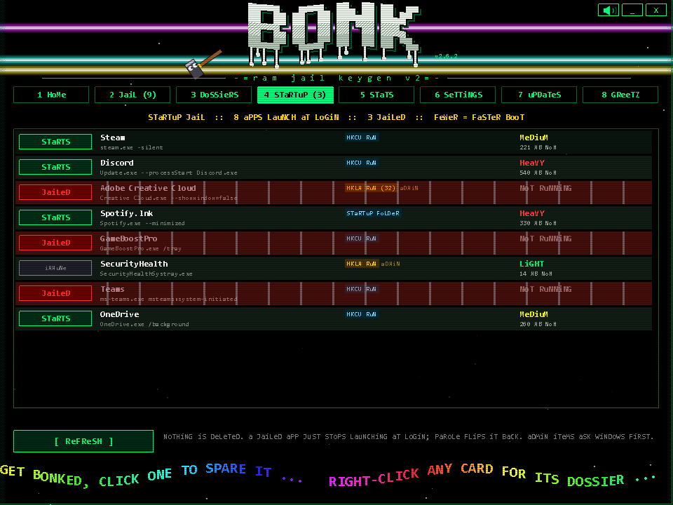

Every app that launches when you log in, from the registry Run keys and the Startup folders, with how heavy it is right now. Click **STARTS** to jail it from startup and **JAILED** to parole it back.

It flips Windows' own StartupApproved switch, the same one Task Manager's Startup tab uses. Nothing is deleted, Task Manager shows the same state, and you can undo anything. Machine-wide entries ask Windows for admin permission first. Windows Security, audio drivers and Bonk Mode itself are immune, and you can make anything else immune with `startupImmune` in your `bonk-list.json`.

### 5 · STATS: the hall of shame

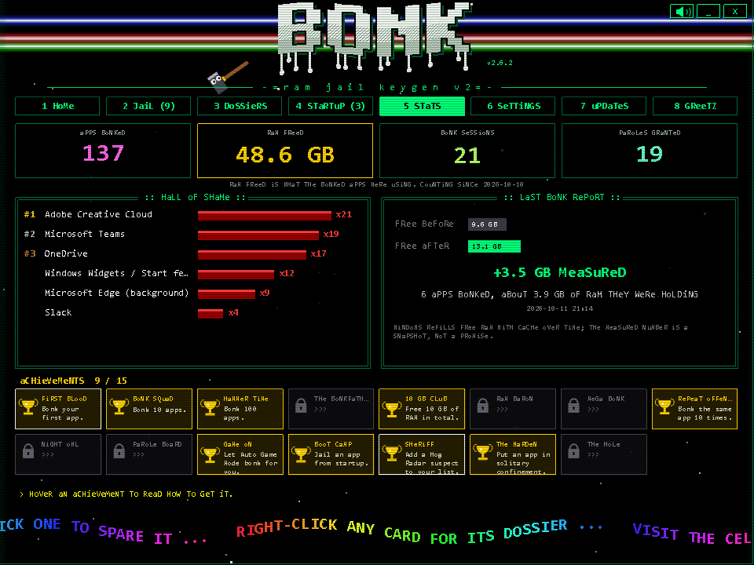

Lifetime counters (apps bonked, RAM freed, bonk sessions, paroles), a **Hall of Shame** ranking your repeat offenders, and a before/after report of your free RAM for the last bonk. Plus **15 achievements**, from **FIRST BLOOD** to **THE BONKFATHER** (bonk 1,000 apps). Unlocking one gets you a banner and a fanfare. Some are secret until you earn them.

### 6 · SETTINGS

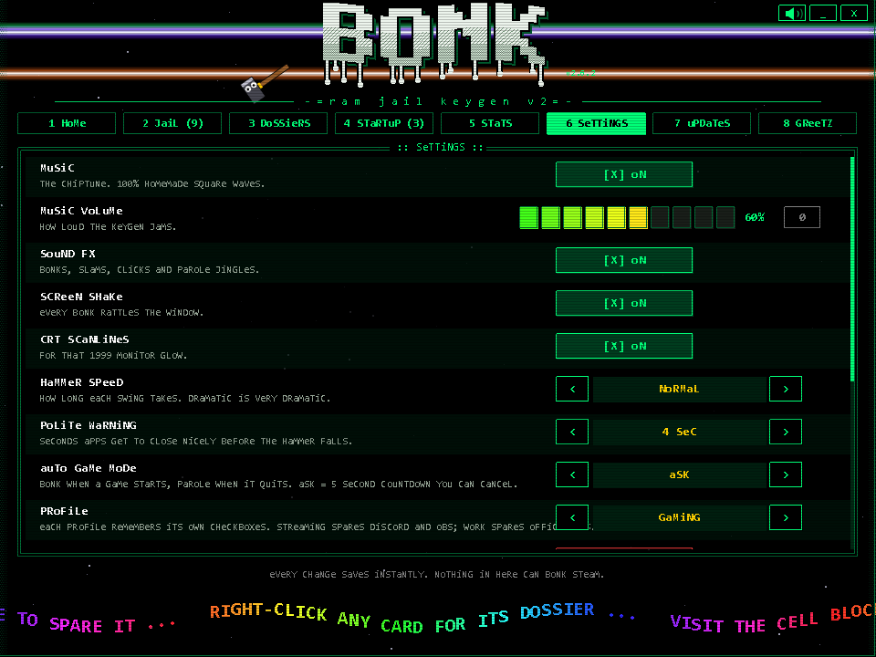

### 7 · UPDATES: patch center

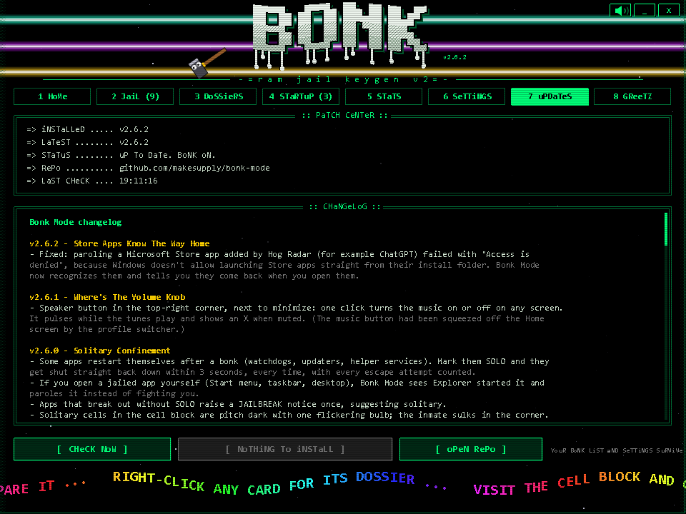

### 8 · GREETZ

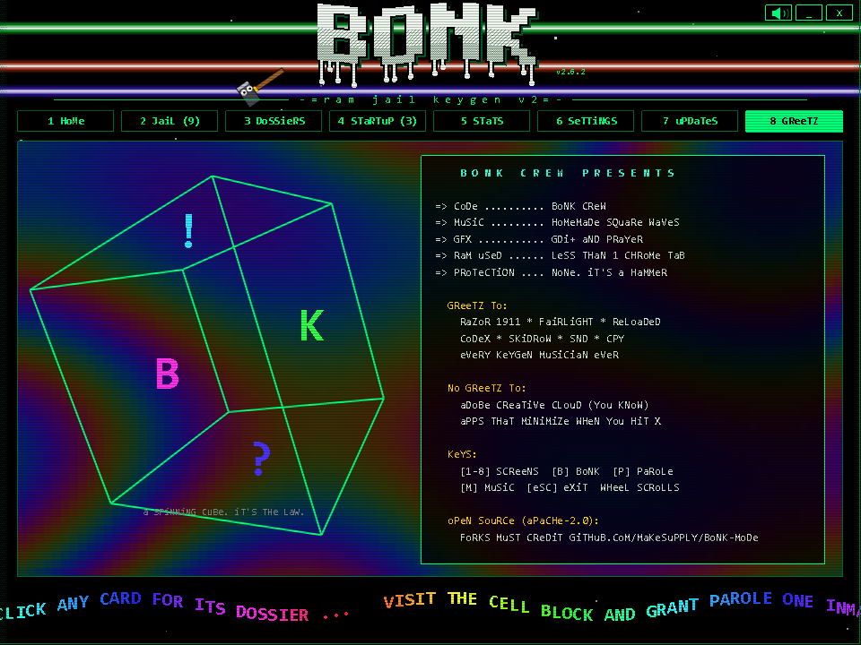

A plasma background and a spinning 3D cube, because every keygen is legally required to have one.

---

## 🚀 Install in 30 seconds

Windows 10 or 11. Uses the PowerShell that's already on your PC. Nothing else to install.

```powershell
git clone https://github.com/makesupply/bonk-mode.git
cd bonk-mode
powershell -ExecutionPolicy Bypass -File .\install.ps1
```

No git? Click **Code → Download ZIP** above, unzip anywhere, right-click `install.ps1` → **Run with PowerShell**.

That adds **Bonk Mode** to your Start Menu, puts a 🔨 in your tray (check the `^` overflow and drag it out), and opens the keygen.

- **Double-click the hammer** (or the Start Menu shortcut) to open the keygen.
- **Right-click the hammer** for the quick menu: bonk, parole, and checkboxes without opening anything.

### Stream Deck and shortcuts

The installer adds **Bonk Mode - BONK NOW** and **Bonk Mode - Parole** to your Start Menu. On a Stream Deck, add a **System > Open** button and point it at one of those shortcuts: one press clears the room. From scripts you can also run:

```powershell
.\bonk-mode.ps1 -Bonk
.\bonk-mode.ps1 -Parole
.\bonk-mode.ps1 -SetProfile streaming
```

They talk to the running tray, or start it if it isn't running.

### Keys

| Key | Does |
|---|---|
| `1`-`8` | Switch screens |
| `Ctrl+Alt+B` | BONK from anywhere, even inside a game |
| `Ctrl+Alt+P` | Parole from anywhere |
| `Ctrl+Alt+K` | Open the keygen |
| `B` | BONK 'EM ALL |
| `P` | Parole everyone |
| `M` | Music on/off (or click the speaker in the top-right corner) |
| Mouse wheel | Scroll cards, cells, lists, changelog |
| `Esc` | Close the window (the tray stays) |

---

## 🛡️ What it will never touch

Some processes have **diplomatic immunity**, even if you put them on the list by accident:

Steam and its overlay · Explorer · your GPU driver (NVIDIA containers) · Windows Security / Defender · Windows core processes · PowerShell (it's driving) · Python runtimes (your scripts and agents)

Bonk Mode will not bonk the launcher your game runs on, and it will not bonk Windows.

**How a bonk works:** apps first get a **polite close**, the same message as clicking their X. Browsers save their tabs and chat apps sign off. Anything still standing after the polite warning (4 seconds by default) gets bonked for real. Save your work first. The hammer does not read Word documents.

---

## ⚙️ Settings

Everything is inside the app on screen **6**, and every change saves instantly.

| Setting | What it does |
|---|---|
| Music | The chiptune. 100% homemade square waves. |
| Music volume | 10-step slider, plus a panic 0 button. |
| Sound FX | Bonks, slams, clicks and parole jingles. |
| Screen shake | Every bonk rattles the window. |
| CRT scanlines | For that 1999 monitor glow. |
| Hammer speed | Fast, normal, or **dramatic**. Dramatic is very dramatic. |
| Polite warning | 2, 4 or 8 seconds for apps to close nicely before the hammer. |
| Auto game mode | **Off**, **ask** (5 second countdown you can cancel) or **auto**. |
| Profile | Gaming, streaming, work or battery. Each keeps its own checkboxes. |
| Turbo power plan | Off by default. High performance while bonked, your own plan back on parole. A crash can't strand you on it. |
| Hog radar | Flag heavy apps (RAM or 10%+ CPU) that aren't on your list. |
| Radar threshold | 200, 400, 800 or 1500 MB before an app becomes a suspect. |
| Solitary confinement | Jailed apps marked SOLO get shut back down if they restart themselves. |
| Global hotkeys | Ctrl+Alt+B / P / K, working inside games. |
| Start with Windows | Hammer in the tray at login. |
| Check for updates | Looks for a new release on GitHub on open and every 6 hours. |

### Make the list yours

The first run copies `bonk-list.example.json` to your own `bonk-list.json` (never uploaded, never overwritten by updates). Click **[EDIT LIST]** to add any app:

```json
{ "label": "Some Launcher", "enabled": true, "names": ["SomeLauncher", "SomeLauncherHelper"] }
```

| Field | Meaning |
|---|---|
| `names` | Process names without `.exe`. Find them in Task Manager → Details. |
| `paths` | Optional wildcards on the exe path, like `"*\\Corsair\\*"`, to catch every helper. |
| `enabled` | `true` = gets bonked. |
| `relaunch` | Leave it out to reopen the same exe on parole, `null` if the app comes back on its own, or a list of `{ "file": ..., "args": ... }`. `%LOCALAPPDATA%`-style variables work. |

The starter list only sentences the obvious freeloaders: cloud sync, work chat, Adobe's tray army, Widgets, and so on. **Discord, Spotify, browsers, game launchers and mouse/keyboard/RGB software start out SPARED**, because closing them mid-game can kill your voice chat, music, lighting, or mouse DPI. Your call.

---

## 🔄 Live updates

Screen **7** is the patch center. It checks this repo, shows you the changelog, and when there's a new version you click **[INSTALL]**, watch a very official-looking hex dump scroll by, and Bonk Mode restarts itself on the new version.

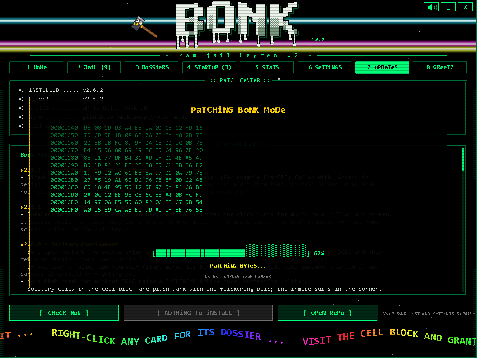

- **Git clone:** it runs `git pull --ff-only`.
- **ZIP install:** it downloads the repo ZIP and replaces only the program files.
- **Never touched:** your `bonk-list.json`, `settings.json`, and jail roster.
- **Nothing installs without your click.** The tray only shows a notification when a new version is out.

---

## 🪶 Is it heavy?

It's a RAM tool, so it had better not be a RAM hog.

- **Tray only:** idles quietly with one timer per minute.
- **Keygen open:** a single GDI+ window at ~30 fps, around **7% of one CPU core**. The music is synthesized live from square waves, so there are **no audio files at all**.
- **Keygen closed:** animation and music stop completely.

The whole app is three text files: a PowerShell script, one C# file compiled on first open (and cached), and a JSON list. No installer, no service, no telemetry, no account, no Electron. *Especially* no Electron.

---

## 🧪 Dry runs

None of these close anything:

```powershell
.\bonk-mode.ps1 -ListOnly          # table of your list, what's running, RAM per app
.\bonk-mode.ps1 -SelfTest          # builds the tray menu and prints what parole would reopen
.\bonk-mode.ps1 -Preview .\shots   # renders every keygen screen to PNG (uses demo apps)
.\bonk-mode.ps1 -GameScan          # which game folders are watched, and is a game running now
.\bonk-mode.ps1 -Radar             # heavy apps that are not on your list yet
.\bonk-mode.ps1 -StartupList       # everything that launches at login, and its jail state
```

---

## 📜 Version history

### v2.6.2 · Store Apps Know The Way Home
- Fixed parole for Microsoft Store apps added by Hog Radar.

### v2.6.1 · Where's The Volume Knob
- Speaker button next to minimize toggles the music from any screen.

### v2.6.0 · Solitary Confinement
- Mark a jailed app SOLO and it gets shut straight back down whenever it restarts itself, with escape attempts counted.
- Opening a jailed app yourself paroles it instead. Dark solitary cells, a siren, two new achievements.

### v2.5.0 · Hotkeys, Stream Deck and stats
- Global hotkeys (Ctrl+Alt+B / P / K) that work inside games.
- -Bonk, -Parole and -SetProfile remote control, plus BONK NOW and Parole shortcuts for Stream Deck.
- Stats screen with Hall of Shame, before/after RAM report and 13 achievements.

### v2.4.0 · Profiles, CPU and disk
- Gaming, streaming, work and battery profiles that remember their own checkboxes.
- CPU and disk on every card, CPU HOG badges, CPU line on the dossier chart, radar catches CPU hogs.
- Opt-in turbo power plan while bonked, crash-safe restore.

### v2.3.0 · Startup Jail
- New Startup screen: jail apps from launching at login with Windows' own switch. Nothing deleted, fully reversible.
- Admin entries ask Windows first; security and audio drivers are immune.

### v2.2.0 · Hog Radar
- Sweeps for heavy apps that aren't on your list and flags them as NEW SUSPECTS with one-click add or spare-forever.
- Never suggests Windows, shared runtimes or dev/server runtimes.

### v2.1.0 · Auto Game Mode
- Bonks automatically when a game starts (5 second countdown you can cancel, or fully auto) and paroles when it quits.
- Watches all Steam libraries plus Epic, Xbox, EA, Ubisoft, GOG and your own folders. Never bonks the game itself.
- Fixed: parole now reopens apps with a single relaunch command.

### v2.0.1 · Credit Where Credit Is Due
- Relicensed to **Apache 2.0 + NOTICE**: forks and derivatives must credit the original.
- Credit added to the Greetz screen, the scroller and the source headers.

### v2.0.0 · The Cell Block Update
- Six screens in one keygen: **Home, Cell Block, Dossiers, Settings, Updates, Greetz**, with glitch-wipe transitions.
- Home groups apps under **GONNA GET BONKED / SPARED / IN JAIL** with big readable names.
- Targets get pulsing crosshairs and nervous sweat.
- **Cell Block** with pacing, yelling inmates and one-at-a-time parole.
- **Dossiers** with mugshots, aliases, parole plans, rap sheets and live RAM charts. Bonk or parole a single app.
- **In-app settings** for music, volume, SFX, shake, scanlines, hammer speed, polite warning, autostart and update checks.
- **Live updater** that checks GitHub, shows the changelog, installs with one click and restarts itself.
- A warden hammer, a googly-eyed mascot hammer, a tumbleweed, a plasma and a spinning cube.

### v1.1.0 · The Keygen
- Double-click the tray hammer for a 1999-style keygen window.
- Wobbling dithered ASCII logo, copper bars, starfield, CRT scanlines, typing NFO box.
- Hammer animation with screen shake, comic bursts, RAM-bit particles and prison bars.
- Original chiptune and sound effects synthesized live.

### v1.0.0 · First Bonk
- Tray hammer with BONK 'EM ALL and Release from RAM jail.
- Polite close first, force close after a few seconds.
- Kill list in `bonk-list.json` with checkboxes in the tray menu.
- Diplomatic immunity for Steam, Explorer, the GPU driver and Windows core.

Full notes: [CHANGELOG.md](CHANGELOG.md) · What's next: **[ROADMAP.md](ROADMAP.md)** (Auto Game Mode, Hog Radar, Startup Jail and more)

---

## ❓ FAQ (Frequently Bonked Questions)

**Will this make my game faster?**
If background apps are fighting your game for RAM, CPU or disk, yes, often noticeably on 8-16 GB machines. The biggest win is usually fewer things waking up mid-game to sync, update or show you a popup. If you have 64 GB and nothing running, Bonk Mode will mostly make you feel powerful. That's also valid.

**Something dodged the bonk.**
Some apps run as administrator or have a watchdog that respawns them. The status line tells you who dodged.

**Is it safe?**
It only closes what's on your list, it says hello before it hits, and it has a hard-coded immunity list. Read `bonk-mode.ps1`: it's one file.

**Why does it look like that?**
Because in 1999 every piece of software you shouldn't have downloaded came with the best music ever written, and we miss it.

**Is the music from a real game?**
No. It's an original tune in the style of 8-bit console music, generated in code every time you open the window.

---

## 💾 Greetz

To RAZOR 1911, FAIRLIGHT, RELOADED, CODEX, SKIDROW, SND, CPY, and every keygen musician who made a 40 KB tracker file slap harder than most albums. This is a love letter to the art, not the piracy. Bonk Mode cracks nothing except your background apps.

No greetz to Adobe Creative Cloud. You know what you did.

---

## 📄 License and credit

Bonk Mode is open source under the **[Apache License 2.0](LICENSE)**. Use it, change it, fork it, ship it, even sell it.

**One rule: credit the original.** If you distribute Bonk Mode or anything built from it, keep the [NOTICE](NOTICE) file (Apache 2.0, section 4d), and please put this somewhere people will see it:

> Based on Bonk Mode by makesupply · https://github.com/makesupply/bonk-mode

Versions up to v2.0.0 were released under MIT. Everything from v2.0.1 on is Apache 2.0.

---

<div align="center">

**Apache 2.0. Credit the hammer. Bonk responsibly.** 🔨

</div>
